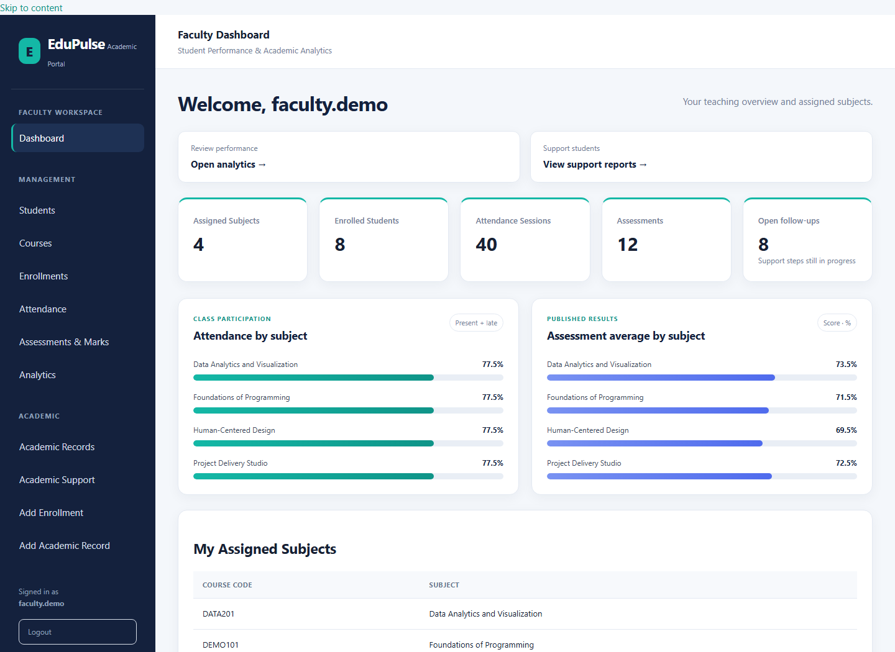
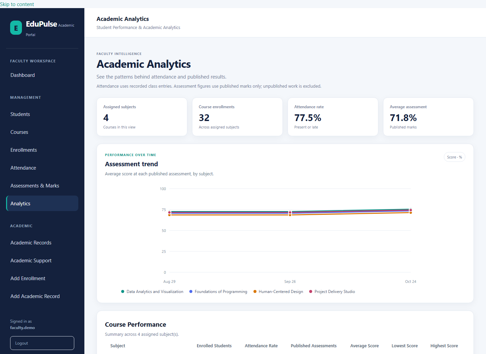
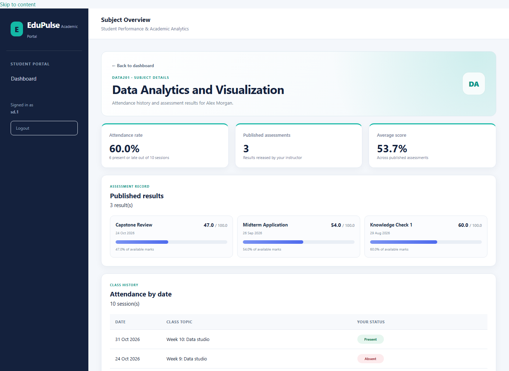

# EduPulse
### Explainable Academic Insights & Student Support

[](https://github.com/rohanronniie/EduPulse/actions/workflows/tests.yml)
[](LICENSE)

EduPulse is a web application for managing student academic records and identifying areas where additional academic support may be needed. It brings attendance, assessment results, and assignment completion into one place, with explanations that show how each academic indicator was generated.

Rather than treating academic performance as a black-box prediction, EduPulse uses transparent, rule-based evaluation. Faculty can review the evidence behind an indicator, explore possible interventions through a What-If simulator, and use course-level analytics to understand academic activity.

The project focuses on three practical engineering concerns: **explainable evaluation, controlled access to academic information, and reliable handling of student records.**

> **Portfolio demo:** the included sample cohort is fictional. EduPulse is a demonstration project, not a validated academic decision system.

## Screenshots

These screenshots are from the running application populated with the included synthetic demo cohort. They show real faculty dashboards, course analytics, and a student's dated subject record.

| Faculty dashboard | Academic analytics | Student subject detail |
|---|---|---|
| [](docs/images/faculty-dashboard.png) | [](docs/images/analytics-dashboard.png) | [](docs/images/student-subject-detail.png) |

To explore the same workflows locally, follow [Getting started](#getting-started) and the demo account instructions below.

## Features

### Academic records and evaluation

- Manage students, courses, and course enrollments.
- Maintain attendance percentages, assessment scores, and assignment completion data.
- Evaluate academic records using configurable rules.
- Identify attendance concerns, declining assessment performance, and low assignment completion.
- Generate reports containing the reason for each finding and the supporting evidence.
- Turn suggested support actions into dated follow-ups with staff notes and open, in-progress, or completed status.

### What-If intervention simulator

Faculty can explore hypothetical changes to attendance, assessment scores, and assignment completion to see how the evaluation changes. The simulation compares the proposed scenario with the existing record without modifying the saved academic data.

### Faculty and student portals

- Role-based authentication for faculty and students.
- Faculty access to assigned courses, attendance management, assessment creation, marks entry, and result publishing.
- Attendance sessions can be reopened and corrected; recording the same course, date, and topic updates the existing session.
- Student access to their academic information and published assessment results.
- Subject pages group published marks with dated attendance history.
- Access restrictions that prevent students from opening faculty-only pages.
- Attendance and assessment workflows tied to course enrollment.

### Analytics dashboard

Student dashboards group work by subject. Each subject opens a dated attendance history and its published assessment results. Faculty dashboards compare attendance and published score averages by subject; the analytics page adds course comparisons and a native SVG trend chart without a third-party chart CDN.

### Support follow-through

Academic Support combines explainable indicators with a lightweight follow-up workflow. Faculty can record an action, set a due date, add staff notes, and track progress. This helps teams see whether a support step was started and completed; it does not claim that the action caused an academic outcome.

The repository includes an idempotent demo seed with **eight fictional students, four courses, ten weeks of attendance, three published assessments per course, and sample support follow-ups**. The names and records are synthetic and should never be presented as real institutional data.

Academic reports show where their inputs come from. The saved-record report uses live attendance and published assessment data when available, with saved values as fallbacks; course support reports use live attendance and published marks, with assignment completion from saved academic records.

### Validation and security

- Input validation for academic records, marks, and assessment data.
- Duplicate checks for student codes, course codes, and enrollments.
- Flask-WTF CSRF protection for form submissions.
- Environment-based application secret configuration.
- Automated tests covering the evaluation logic, validation, routes, and application workflows.

## Technology

| Area | Technology |
|---|---|
| Language | Python |
| Web framework | Flask |
| Database | SQLite for local use; PostgreSQL connection support |
| Database toolkit | SQLAlchemy |
| Frontend | HTML, CSS, JavaScript, Jinja |
| Security | Flask-WTF, session-based authentication |
| Testing | pytest |
| Production server | Waitress |
| Version control | Git, GitHub |

## How the evaluation works

EduPulse currently uses a rule-based academic evaluation engine, not a trained machine-learning model.

The engine examines three indicators:

1. **Attendance:** compares attendance against a configured threshold.
2. **Assessment trend:** checks for a significant decline between assessment scores.
3. **Assignment completion:** compares completed assignments with the total assigned.

Each finding includes a status, an explanation, and supporting values. Where appropriate, the report also suggests possible academic support interventions.

This design makes the evaluation easier to inspect and test. It also keeps the system honest about what it can establish: a rule-based indicator can highlight a concern, but it cannot establish that a student will fail or predict an individual's future performance.

Thresholds are configurable demonstration settings. They have not been established as universally valid measures of academic success.

## Application structure

The project follows a modular Flask structure, separating database models, academic evaluation, route handlers, and templates.

```text
EduPulse/
├── src/
│   ├── __init__.py
│   ├── database.py
│   ├── demo_config.py
│   ├── models.py
│   ├── academic_models.py
│   ├── academic_engine.py
│   ├── portal_models.py
│   ├── auth_routes.py
│   ├── student_routes.py
│   ├── course_routes.py
│   ├── enrollment_routes.py
│   ├── academic_routes.py
│   ├── academic_support_routes.py
│   ├── attendance_routes.py
│   ├── assessment_routes.py
│   ├── analytics_routes.py
│   ├── templates/
│   │   └── student_course_detail.html
│   └── static/
├── .github/
│   └── workflows/
│       └── tests.yml
├── docs/
│   ├── images/
│   └── PROJECT_BRIEF.md
├── tests/
├── Dockerfile
├── LICENSE
├── Procfile
├── requirements.txt
├── run.py
├── wsgi.py
├── seed_demo.py
└── README.md
```

The academic evaluation engine is kept separate from the web interface, allowing its rules to be tested independently. Database models represent academic records, enrollments, user accounts, attendance sessions, assessments, and marks. Route modules handle the corresponding application workflows.

## Getting started

### Prerequisites

- Python 3.14, as used during development.
- Git.
- Windows PowerShell or another terminal that supports the commands below.

### 1. Clone the repository

```powershell
git clone https://github.com/rohanronniie/EduPulse.git
cd EduPulse
```

### 2. Create and activate a virtual environment

```powershell
python -m venv .venv
.\.venv\Scripts\Activate.ps1
```

### 3. Install dependencies

```powershell
python -m pip install -r requirements.txt
```

### 4. Configure local settings

Copy the example environment file, then generate a secret for the current PowerShell session:

```powershell
Copy-Item .env.example .env
$env:EDUPULSE_SECRET_KEY = python -c "import secrets; print(secrets.token_hex(32))"
```

`run.py`, `wsgi.py`, and the demo seeder load values from `.env`; process environment values take precedence. You can put your generated key in `.env` to reuse it locally. Keep `.env` out of Git.

The app requires `EDUPULSE_SECRET_KEY` and will not start without one. There is no built-in default key.

### 5. Start the application

```powershell
python run.py
```

Open the local address printed by the development server, normally:

`http://127.0.0.1:5000`

The application initializes its SQLite database according to its configuration.

### 6. Load demonstration data (optional)

The repository includes a demonstration seed script. To populate the database with the project's demo accounts and data, run:

```powershell
python seed_demo.py
```

The seed is idempotent for its demo records and updates demo account passwords. It does not delete unrelated records. It creates one faculty account and an individual student login for each fictional profile. Use `faculty.demo` for the faculty workspace; student logins are `sd.1` through `sd.8`, and the sign-in page lists them after seeding. All demo accounts use the short shared password `Demo123!`. Use the seed only with a disposable or explicitly chosen demonstration database, never with institutional data or a deployed database. These shared demo credentials must not be used in a deployment.

After seeding, the sign-in page lets a reviewer select an account and signs in with one click. To test student-specific views, choose different `sd.*` accounts; the faculty account opens course management, marks, analytics, and support follow-ups.

### 7. Run the tests

Stop the development server if necessary, then run:

```powershell
python -m pytest -q
```

**Latest verified test result: 79 passed.** This result includes the current dashboard, subject detail, and marks-view updates.

Run the suite again after making changes; the result above records the latest verification, not a guarantee about future code changes.

## Testing and verification

The test suite covers academic evaluation, input validation, database operations, authentication-related workflows, attendance, assessments, marks, and application routes.

The complete test command is `python -m pytest -q`. Tests use isolated databases and do not require the demonstration seed.

The `/health` endpoint checks both the application and its configured database connection and returns a service-unavailable response if the database cannot be reached.

## Deployment preparation

`wsgi.py` serves the application with Waitress and uses the hosting provider's `PORT` value. `Procfile` is provided for platforms that use it; the Dockerfile provides a small, non-root container image. Flask's built-in development server in `run.py` is for local development only. Production WSGI serving is prepared separately, consistent with Flask's deployment guidance. [Flask production deployment guidance](https://flask.palletsprojects.com/en/stable/deploying/), [Waitress documentation](https://docs.pylonsproject.org/projects/waitress/en/stable/)

Configure these environment variables on the hosting platform:

- `EDUPULSE_ENV=production` enables secure session cookies and HSTS.
- `EDUPULSE_SECRET_KEY` must be a strong, private value supplied by the platform's secret store.
- `EDUPULSE_DATABASE_URL` should point to a persistent PostgreSQL service using `postgresql+psycopg://...` for a public deployment. SQLite remains the default for local development.
- `PORT` is normally provided by the host.

The app creates missing tables at startup, but it does not include a versioned migration system. Existing data, infrastructure, domain/TLS, backups, monitoring, and privacy requirements must be reviewed before a public launch. Do not seed the demo cohort in production.

## Limitations and responsible use

EduPulse is a portfolio project and demonstration of academic record management and explainable rule-based analytics. It has not been validated as a production academic decision-making system.

- The evaluation rules are indicators for review, not predictions of student outcomes.
- The configured thresholds require context-specific validation before use in an educational institution.
- Intervention suggestions should support, not replace, informed decisions by academic staff.
- Real student records require appropriate authorization, privacy controls, retention policies, backups, and operational safeguards.
- The follow-up log is an operational aid, not a validated intervention-outcome study.
- Public deployment scaffolding is included, but a versioned database migration and backup/restore process are still needed before handling institutional records.

Demonstrations should use synthetic data or data that is appropriately authorized for the intended purpose.

## Possible next steps

- Add controlled data export and reporting.
- Add a versioned migration and backup/restore workflow.
- Add broader integration and security testing.
- Evaluate academic indicators using appropriately governed data and clearly defined criteria.
- Prepare a deployment configuration with production-grade monitoring and operational safeguards.

Machine learning should be considered only if a justified use case and suitable evaluation data become available.

## Author

**Rohan S**

GitHub: [rohanronniie](https://github.com/rohanronniie)

Repository: [EduPulse](https://github.com/rohanronniie/EduPulse)
